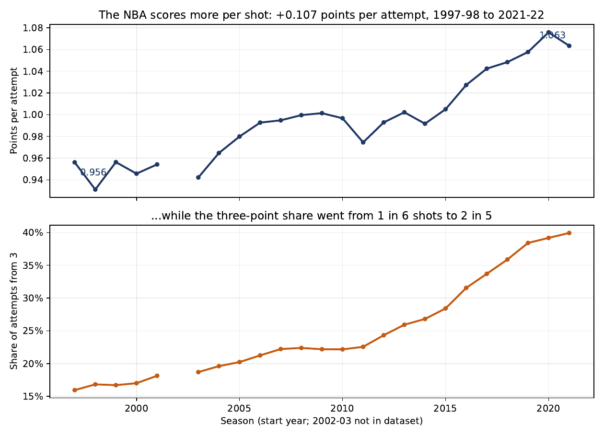
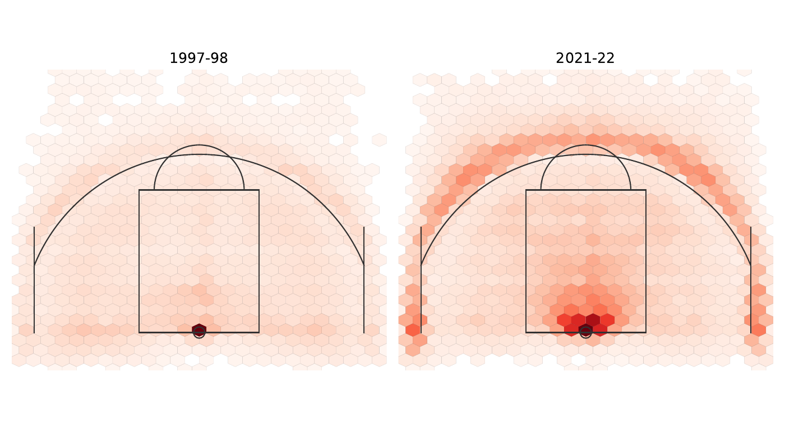
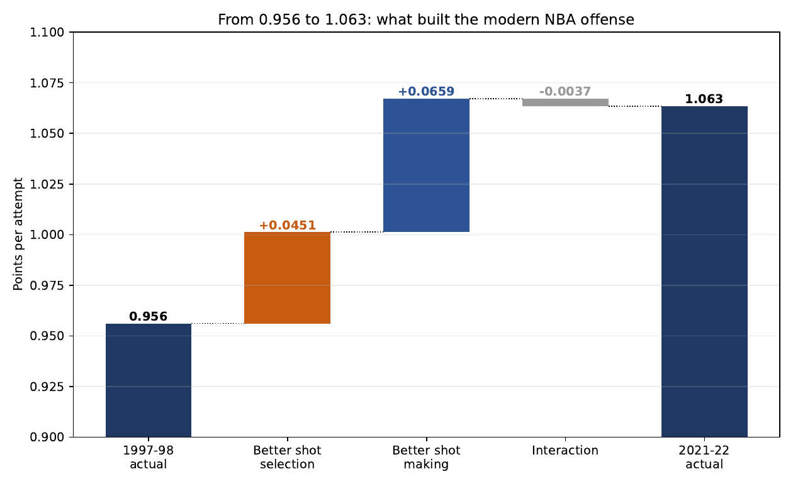

# Shot Selection or Shot Making? The Rise in NBA Shooting Efficiency, 1997–2022

**Diego Luaces** · University of Central Florida · [Read the paper (PDF)](Papers/Papers.pdf)

## Research question

Between 1997–98 and 2021–22, NBA points per shot attempt rose from **0.956 to 1.063** (+0.107), worth roughly 9 points per team per game. Over the same period the league abandoned the mid-range jumper for threes. This project asks **why** efficiency rose:

- **Shot selection:** did players move their attempts to more valuable locations?
- **Shot making:** did players convert better from the same locations?

The answer tells a team whether to invest in strategy and analytics (selection) or in player development (making).

## Main finding

An exact counterfactual decomposition of the points-per-attempt identity, using 4,678,387 field goal attempts over 24 regular seasons, splits the +0.107 gain into:

| Component | Change in PPA | Share of gain |
|---|---:|---:|
| Shot making (2021 make rates on the 1997 shot mix) | +0.0659 | 61% |
| Shot selection (1997 make rates on the 2021 shot mix) | +0.0451 | 42% |
| Interaction | −0.0037 | −3% |

The two forces happened in **different places on the floor**:

- **The three-point revolution was a selection story, not a skill story.** The share of attempts from three went from about 1 in 6 to 2 in 5, while above-the-break three-point accuracy barely moved (34.2% → 34.6%).
- **Shot making happened at the rim and in the paint.** Restricted-area conversion rose from 60.2% to 65.3% and paint conversion from 37.0% to 42.8%, on a close-range share of attempts that stayed at about 47%.
- **The interaction is negative** because conversion improved most in zones the league was abandoning. Skill gains on shots nobody takes anymore are worth less.







## Repository layout

```
Code/       SQL-in-Python analysis scripts (Tasks 0-4), figure script, and their CSV outputs
Figures/    Figure1-6.pdf as used in the paper (PNG copies of 1, 4, 6 for this README)
Papers/     Papers.tex, references.bib, compiled Papers.pdf
DoWork.sh   Runs the full pipeline end to end
```

| Script | What it does | Output |
|---|---|---|
| `task0_audit.py` | Audits the `shots` table: columns, row count, date range, outcome coding, `GAME_ID` format | printed only |
| `task1_season_summary.py` | Decodes season from `GAME_ID` (robust to the pandemic-shifted calendars); PPA and 3PT share by season | `season_summary.csv` |
| `task2_zone_by_season.py` | Attempts, make rate, point value, and share for each zone and season | `zone_by_season.csv` |
| `task3_decomposition.py` | Counterfactual decomposition and zone-level contributions | `decomposition_results.csv`, `decomposition_by_zone.csv` |
| `task4_shot_grid.py` | Bins shot locations into 1-ft cells for the endpoint seasons | `shot_grid.csv` |
| `make_figures.py` | Builds Figures 1–6 from the CSVs | `Figures/Figure1-6.pdf` |

The CSVs in `Code/` are small aggregated results (no shot-level rows), included so the figures and decomposition can be reproduced without the database.

## Data

The shot-level data came from my UCF course, **ECO 4934 (Econometrics of Sports)**, and **are not included in this repository**. To run the full pipeline, place the SQLite database at:

```
Data/nba_shots.db
```

It must contain a `shots` table with `GAME_ID`, `GAME_DATE`, `SHOT_TYPE`, `SHOT_MADE_FLAG`, `SHOT_ZONE_BASIC`, `LOC_X`, and `LOC_Y` (4,678,387 rows; the 2002–03 season is absent from the source).

## How to run

```bash
pip install pandas numpy matplotlib scipy
bash DoWork.sh
```

`DoWork.sh` runs Tasks 0–4 and `make_figures.py`, then compiles the paper with `pdflatex` + `bibtex` if they are installed. Without the database, you can still regenerate the figures from the included CSVs:

```bash
cd Code && python make_figures.py
```

## Tools

- **Python:** pandas, NumPy, matplotlib, SciPy
- **SQL / SQLite:** all aggregation is done in SQL queries against the shot database
- **LaTeX:** paper typeset with natbib/BibTeX
